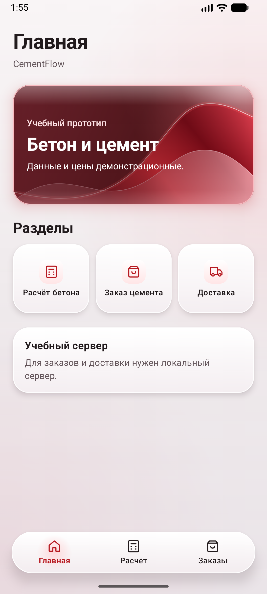
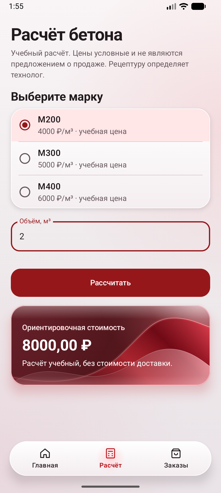
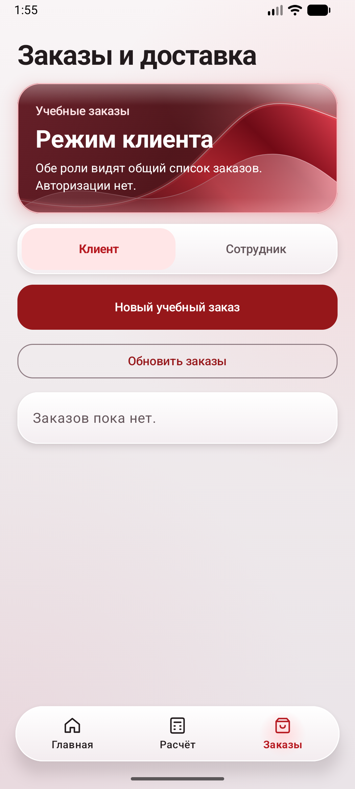

# Клинкер — передача работы

Обновлено 27 ноября 2026. Учебный прототип опубликован в репозитории Klinker. Текущий этап — домашний стенд на Debian. 26 ноября SSH, Java и PostgreSQL были проверены. 27 ноября управление Hyper-V оказалось недоступно из текущего процесса, а SSH по последнему известному адресу не ответил; состояние ВМ не подтверждено. **Точка продолжения** — запустить ВМ, создать учебную базу внутри неё, развернуть Spring Boot и проверить подключение телефона по Wi‑Fi.

## Опубликованная версия

- Репозиторий [Klinker](https://github.com/keepaneyeonyourmind/Klinker), основная ветка `main`. Ранее опубликованная версия — [коммит `0d813c7`](https://github.com/keepaneyeonyourmind/Klinker/commit/0d813c72442c09c1fc950900510c1cdaa1457da3).
- В публикацию вошли Android-приложение, сервер, SQL-схема и учебный каталог. [README](README.md) содержит скриншоты, требования к окружению, инструкции по запуску и порядок работы через Pull Request.
- Для Android добавлены адаптивная иконка с цветными слоями, монохромный слой для системной темы и обычные и круглые ресурсы для разных плотностей экрана. Цветную иконку проверили в системных сведениях о приложении на телефоне.
- После базового коммита уточнены этот документ и описание проекта. Материалы практики и отдельное изменение `MainActivity.kt` остаются локальными и в опубликованную версию не включены.

## Цель и решения

Три начинающих разработчика готовят к защите практики учебный прототип. В приложении есть расчёт примерной стоимости бетонной смеси, заказ цемента, ручное назначение и отслеживание доставки. Для демонстрации доступны Android-эмулятор и телефон, подключённый к компьютеру по USB. Данные, цены, контакты и водители учебные; рецептура, реальные платежи и интеграции предприятия исключены. Возможность развития для компании рассматривается позднее, потребности компании не подтверждены.

Технологии проекта — Kotlin и Jetpack Compose для Android, Kotlin, Spring Boot, JDBC и PostgreSQL для сервера. Калькулятор и заказ — отдельные сценарии. В текущем прототипе заказ содержит один товар, роли переключаются без авторизации. Для дальнейшей разработки утверждено название **«Клинкер»**. В установленном прототипе и в ресурсе `app_name` пока отображается `CementFlow`.

Практика началась 19.11.2026. Предполагаемое окончание — 24.12.2026 или 25.12.2026. Точную дату нужно сверить с документами колледжа. 02.12.2026 — внутренний ориентир готовности приложения и сценария показа. Приложение можно подготовить к показу раньше.

## Реализация

- `android/`: Compose-экраны главной страницы, калькулятора и заказов/доставки. Калькулятор умножает положительный объём на учебную цену за м³, округляет до копеек: М200 — 4000, М300 — 5000, М400 — 6000 ₽/м³. Цены условные; результат не является рецептурой.
- Заказ: один товар, целое количество 1–10000, учебные имя, телефон и адрес. Сервер берёт цену из каталога, сохраняет её на момент заказа и рассчитывает итог. Сотрудник задаёт имя водителя и меняет статус: ожидает → назначена → в пути → доставлена. Доступ к заказам общий, настоящей авторизации нет.
- `server/`: Spring Boot, JDBC и PostgreSQL; API и формат ошибок в `server/API.md`, SQL-схема и товары в `server/sql/`. Сервер слушает `127.0.0.1`, приложение debug-эмулятора обращается к `10.0.2.2:8080`. На Android 17 приложение запрашивает доступ к локальной сети. Для debug-запуска на телефоне предусмотрено [подключение по USB](README.md#телефон-по-usb). Release-сценарий и защищённый удалённый доступ не настроены.

## Интерфейс после редизайна

- **Главная.** Карточка учебного прототипа и три быстрых перехода. «Расчёт бетона» открывает калькулятор, а «Заказ цемента» и «Доставка» ведут на экран заказов.
- **Расчёт.** Пользователь выбирает марку, вводит объём и нажимает «Рассчитать». Сумма появляется в красной карточке. При некорректном объёме поле показывает подсказку.
- **Заказы.** Переключатель «Клиент / Сотрудник» задаёт режим. Клиент видит список заказов и открывает форму из каталога, сотрудник управляет доставкой. У заказа есть подпись с текущим статусом.
- **Навигация.** Нижняя панель открывает «Главную», «Расчёт» и «Заказы». Активная вкладка подсвечена красным. Панель скрывается при открытой клавиатуре, а переключение вкладок заблокировано, пока экран заказов выполняет запрос.
- **Оформление.** Светлый фон, скруглённые карточки со светлой окантовкой, мягкие тени и волны с бликами на красных панелях. Основной цвет кнопок `#96171A`. Эффект стекла выполнен градиентами, тенями и отрисовкой в Jetpack Compose.

### Скриншоты с эмулятора Android 17

  

[Главная](docs/screenshots/home.png) · [Расчёт](docs/screenshots/calculator.png) · [Заказы](docs/screenshots/orders.png)

## Домашний стенд на Debian

- В Windows 11 Pro включили Hyper‑V, затем после перезагрузки проверили службы управления. Создали ВМ второго поколения `Klinker-Debian` с двумя виртуальными процессорами, динамической памятью 1–4 ГиБ и отдельным динамическим VHDX до 30 ГиБ. Путь к базовому диску — `Documents/Virtual Machines/Klinker-Debian/Klinker-Debian.vhdx` в профиле Windows. Установщик Debian видел только виртуальный диск ВМ. Разделы и загрузчик Windows не изменялись.
- Debian 13.8 установили с официального netinst ISO после сверки SHA‑512. Выбрали SSH и стандартные утилиты. Установочный ISO отключился перед первой загрузкой Debian с виртуального диска. В ВМ установили OpenJDK 25.0.5.1 и PostgreSQL 17.12 из репозиториев Debian. Часовой пояс — `Asia/Novosibirsk`.
- ВМ подключена к `Default Switch` Hyper‑V. Вход из Windows проверен под пользователем `klinker` по SSH-ключу. Ключ и файл `known_hosts` находятся в профиле Windows в `%LOCALAPPDATA%\CementFlow\DebianVM`. Адрес ВМ выдаётся динамически. Для управления при ошибке разрешения имени хоста в командах Hyper‑V используйте `-ComputerName localhost`.
- PostgreSQL запущена и слушает `5432` только на loopback внутри Debian. Сервер приложения и подключение телефона к ВМ ещё предстоит настроить. До внедрения аккаунтов API с общим доступом используем только на закрытом учебном стенде.

## Резервный запуск на Windows по USB

На этом компьютере с разрешения пользователя установлена PostgreSQL 17.12, созданы база `cementflow_demo` и отдельная роль `cementflow_app`. Пароли защищены средствами Windows для текущей учётной записи и находятся вне проекта и Git в `%LOCALAPPDATA%\CementFlow`. При проверке на телефоне сервер и база работали. Перед новым показом проверьте доступность сервера.

1. Для заказов и доставки запустите сервер из папки `server` командой `powershell -ExecutionPolicy Bypass -File .\run-local.ps1`. Скрипт использует Java из локальной Android Studio и защищённый пароль текущего пользователя Windows.
2. Откройте папку `android/` в Android Studio и запустите debug-вариант на эмуляторе. При запросе Android 17 предоставьте приложению доступ к локальной сети. Калькулятор работает локально.
3. Для телефона соберите debug-APK с `-PcementflowUsb=true`, настройте `adb reverse tcp:8080 tcp:8080` для выбранного устройства и установите APK. Точные команды приведены в [README](README.md#телефон-по-usb). После переподключения кабеля может потребоваться повторить проброс порта.
4. На компьютерах участников потребуется локальная настройка PostgreSQL и загрузка каталога по [инструкции сервера](server/README.md).

## Что проверено и что нет

- **После редизайна, до добавления иконки.** Ранее прошли Android debug-сборка (`assembleDebug`) и 5 модульных тестов (`testDebugUnitTest`). На эмуляторе Android 17 осмотрены три вкладки, проверены переключение между ними, ввод с клавиатуры, расчёт 2 м³ М200 на 8 000 ₽, пустой список заказов, чтение каталога, прокрутка формы и переключение ролей. Во время осмотра базу использовали только для чтения. Пользователь подтвердил, что дизайн его устраивает.
- **До редизайна.** Прошли сборка и тесты сервера (`build`). На эмуляторе проверили создание заказа, назначение водителя, последовательную смену статуса до «доставлена» и отображение клиенту. Через API проверили отклонение неверного перехода. Созданные для проверки записи удалены.
- **Физический телефон с Android 16.** Прошли установка debug-APK, запуск главного экрана, расчёт 2 м³ М200 на 8 000 ₽, чтение списка заказов и каталога из трёх товаров через USB. Новые заказы в ходе проверки не создавались. Для опубликованной версии заново собрали и установили USB debug-APK, проверили отображение иконки в сведениях о приложении, запуск и загрузку каталога. Круглый и монохромный варианты осмотрены на превью.
- **Остались без проверки.** Полный цикл создания и доставки на новом интерфейсе, сохранность заказа после перезапуска приложения и сервера, release-сборка и работа с нескольких устройств. На Debian 26 ноября повторно проверили SSH, версии Java и PostgreSQL и состояние кластера. Сборку и тесты приложения в этом сеансе не запускали.

## С чего продолжить

1. Создать в Debian отдельную учебную базу и роль приложения. Применить [схему](server/sql/schema.sql) и [учебный каталог](server/sql/demo-data.sql). Старый Windows-стенд пригодится для показа по USB.
2. Собрать и развернуть Spring Boot как службу `systemd`. Задать подключение через `CEMENTFLOW_DB_URL`, `CEMENTFLOW_DB_USER` и `CEMENTFLOW_DB_PASSWORD`. Хранить настройки с секретами на сервере вне репозитория.
3. Настроить закрытый доступ с телефона по домашнему Wi‑Fi и адрес API в тестовой Android-сборке. После согласования проверки пройти полный цикл учебного заказа до статуса «Доставлена», сверить цену и статус, затем проверить сохранение после перезапуска Spring Boot и ВМ.

27 ноября продолжить настройку не удалось: у процесса нет прав управления Hyper‑V, SSH по последнему известному адресу не ответил. Для продолжения нужно запустить `Klinker-Debian`. `Default Switch` использует отдельную NAT-сеть, поэтому закрытый маршрут к телефону ещё нужно определить и проверить. На стенде изменений не вносили.

## Согласованный план

| Блок | Результат |
| --- | --- |
| **1а. Домашний стенд** | Spring Boot и PostgreSQL на Debian, проверка телефона по Wi‑Fi без USB и восстановление учебной базы из копии. Сейчас готова ВМ с установленной PostgreSQL. |
| **1б. Отдельный сервер** | Перенести приложение и базу на сервер, который работает при выключенном ноутбуке. Бесплатный Angie принимает HTTPS от Android и будущей Windows-утилиты и проксирует запросы в Spring Boot на `127.0.0.1:8080`. PostgreSQL остаётся внутри серверной сети. До авторизации доступ к стенду закрытый. Angie PRO рассматривается при подтверждённом требовании к ПО из российского реестра. |
| **2. Аккаунты и заказы** | Самостоятельная регистрация по почте и паролю через Spring Security. Заказчик видит свои заказы. Сотрудник управляет доставкой в своей рабочей области. Администратор выдаёт и отзывает права. Сервер проверяет их при каждом защищённом действии. |
| **3. Профиль и почта** | Вкладка «Профиль» с ФИО, ролью, статусом и счётчиками заказов. Подтверждение почты, смена данных и восстановление пароля. |
| **4. Двухфакторная защита** | TOTP через Google Authenticator или Яндекс Ключ. Для заказчика 2FA добровольная, для сотрудника и администратора обязательная. При выдаче ролей администратор подтверждает вторым фактором действие, а сотрудник получает повышенные права после настройки своей 2FA. Для восстановления предусмотрены одноразовые резервные коды. |
| **5. Администрирование** | Windows-утилита управляет ролями через защищённый серверный API. Выдача и отзыв прав фиксируются в журнале. |
| **6. Передача компании** | Компания получает контроль над репозиторием, инфраструктурой, резервным копированием, доменом, почтой и подписью Android-релизов. Её ответственные могут поддерживать систему со своих устройств и аккаунтов. |

Для пилота выбор между обычной PostgreSQL в российском дата-центре и Postgres Pro зависит от требований ИТ компании к размещению и реестру ПО.

## Практика и материалы

- Для передачи проекта команде владельцу нужно пригласить участников на GitHub и согласовать, кто отвечает за приложение, проверку сценария и материалы защиты. [Инструкция для команды](README.md#работа-в-команде)
- К показу 02.12.2026 выбрать основное устройство, подготовить учебные данные и отрепетировать расчёт, заказ и доставку. USB и эмулятор остаются вариантами показа. Сверить дату окончания практики с документами колледжа.
- Согласованный план есть на личной странице ChatGPT «Клинкер план разработки и передачи» и в Obsidian в `cementflow/CementFlow — план аккаунтов и доступа.md`. В той же папке находятся заметки об идее и плане практики, подробный план разработки и цветовая палитра.
- Даты, результаты и подтверждённый вклад участников записывайте в `cementflow/CementFlow — журнал работ по практике.md`. Из журнала подготовим дневник и отчёт. Заметка «Навыки Codex для дизайна» находится в корне хранилища.

Проверки запускаются в согласованном объёме. Коммиты, отправка, слияние, публикация и системные установки требуют отдельного поручения или согласия пользователя. Перед изменением существующих файлов вне Git сохраняются копии в `backups/`.
