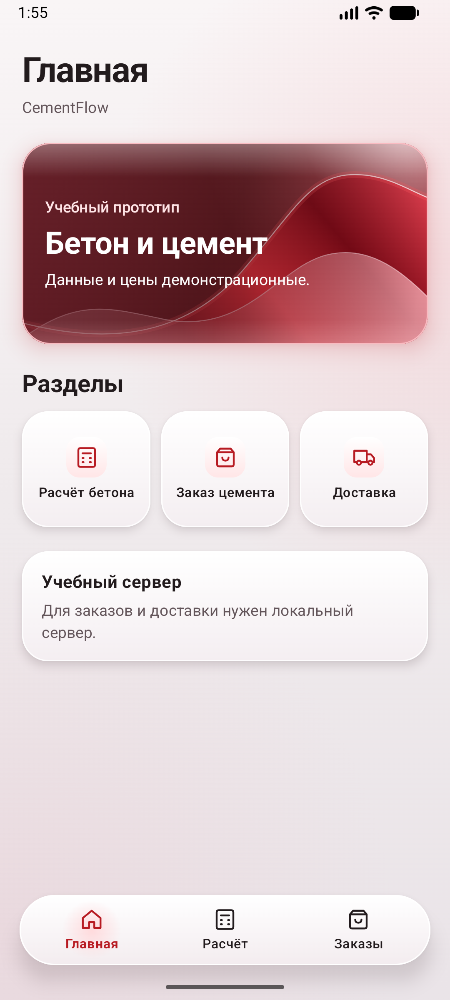
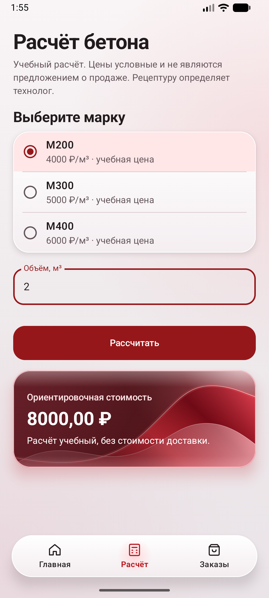
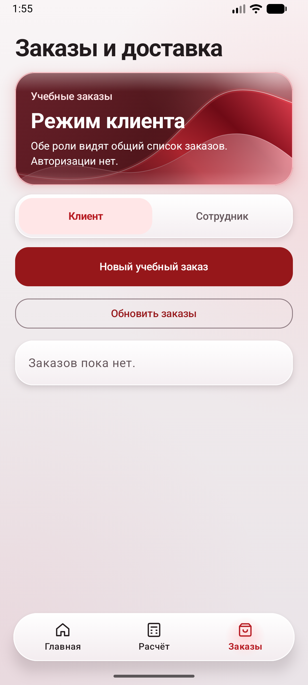

<p align="center">
  
</p>

<h1 align="center">Клинкер (CementFlow)</h1>

<p align="center">
  Учебное Android-приложение для оценки стоимости бетона, заказа цемента и отслеживания доставки.
</p>

Проект получил название «Клинкер»; в текущей установленной версии приложения пока отображается CementFlow. Состояние домашнего стенда и следующие шаги описаны в [передаче работы](HANDOFF.md).

<p align="center">
  <a href="#возможности">Возможности</a> ·
  <a href="#запуск">Запуск</a> ·
  <a href="#работа-в-команде">Работа в команде</a>
</p>

## Возможности

| Раздел | Действия |
| --- | --- |
| Калькулятор | Выбрать марку М200, М300 или М400, указать объём и получить ориентировочную стоимость смеси. Расчёт работает без сервера. |
| Заказы | Выбрать товар из каталога, указать количество и учебные контактные данные, оформить заказ и посмотреть его статус. |
| Доставка | Переключиться в режим сотрудника, назначить водителя и обновить статус доставки. |

<table>
  <tr>
    <th>Главная</th>
    <th>Расчёт</th>
    <th>Заказы</th>
  </tr>
  <tr>
    <td></td>
    <td></td>
    <td></td>
  </tr>
</table>

## Архитектура

| Компонент | Технологии | Назначение |
| --- | --- | --- |
| [Android-приложение](android/) | Kotlin, Jetpack Compose | Интерфейс клиента и сотрудника, локальный расчёт стоимости |
| [Сервер](server/) | Kotlin, Spring Boot, JDBC | REST API каталога, заказов и доставки |
| [База данных](server/sql/) | PostgreSQL | Каталог, заказы и текущее состояние доставки |

Маршрут доставки в приложении: **Ожидает → Назначена → В пути → Доставлена**. Цены и контакты демонстрационные. Роли переключаются без авторизации, поэтому используйте только учебные данные.

## Запуск

### Подготовка

Понадобятся Git, Android Studio с Android SDK 37 и Platform-Tools, JDK 25 для сервера и локальная PostgreSQL. Для установки на устройство требуется Android 7.0 (API 24) или новее.

```bash
git clone https://github.com/keepaneyeonyourmind/Klinker.git
cd Klinker
```

Для заказов и доставки создайте учебную базу, загрузите схему и каталог, затем запустите сервер на порту 8080. Команды и переменные окружения приведены в [инструкции сервера](server/README.md). Сервер слушает только локальный адрес. [Описание API](server/API.md).

### Эмулятор

1. Откройте каталог `android/` в Android Studio и дождитесь синхронизации Gradle.
2. Выберите эмулятор и нажмите **Run**. Debug-сборка подключается к серверу через `10.0.2.2:8080`.
3. Если Android 17 запросит доступ к локальной сети при открытии заказов, разрешите его.

### Телефон по USB

1. Включите отладку по USB, подключите телефон и подтвердите доступ для компьютера.
2. Выполните команды в PowerShell из каталога `android/`. Замените `SERIAL` на идентификатор телефона из вывода `adb devices`. Используйте `adb` из Android SDK Platform-Tools.

   ```powershell
   adb devices
   .\gradlew.bat :app:assembleDebug -PcementflowUsb=true
   adb -s SERIAL reverse tcp:8080 tcp:8080
   adb -s SERIAL install -r .\app\build\outputs\apk\debug\app-debug.apk
   adb -s SERIAL shell am start -n com.example.cementflow/.MainActivity
   ```

3. Подтвердите установку на экране телефона, если появится запрос. После переподключения кабеля повторите `adb reverse`, если каталог и заказы перестали загружаться.

## Проверки

| Команда PowerShell | Где выполнить | Что проверяет |
| --- | --- | --- |
| `.\gradlew.bat :app:testDebugUnitTest` | `android/` | Правила расчёта стоимости бетона |
| `.\gradlew.bat :app:assembleDebug` | `android/` | Сборку debug-APK с настройками для эмулятора |
| `.\gradlew.bat test` | `server/` | Правила заказа и переходы статусов доставки |

## Работа в команде

1. Владелец приглашает участников через **Settings → Collaborators**. Участник принимает приглашение и клонирует репозиторий один раз.
2. Перед своим блоком обновите `main` и создайте ветку задачи.

   ```bash
   git switch main
   git pull --ff-only
   git switch -c feature/order-form
   ```

3. Проверьте изменения, добавьте нужные файлы в коммит и отправьте ветку командой `git push -u origin feature/order-form`. Откройте Pull Request в `main` и укажите, что сделано и как проверено.
4. После слияния следующий участник снова обновляет `main` и создаёт свою ветку от актуальной версии.

